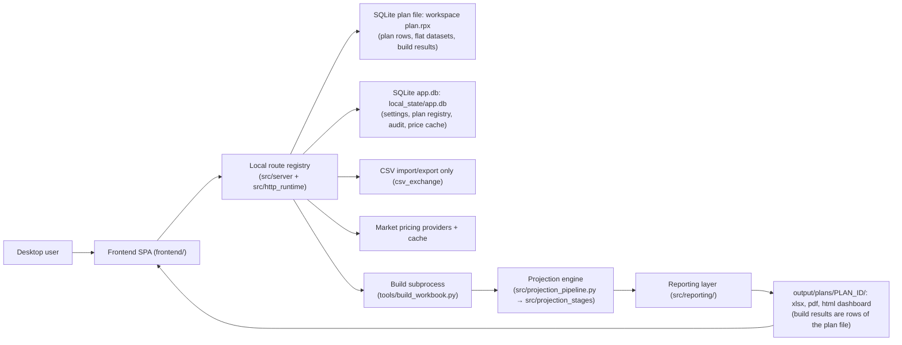
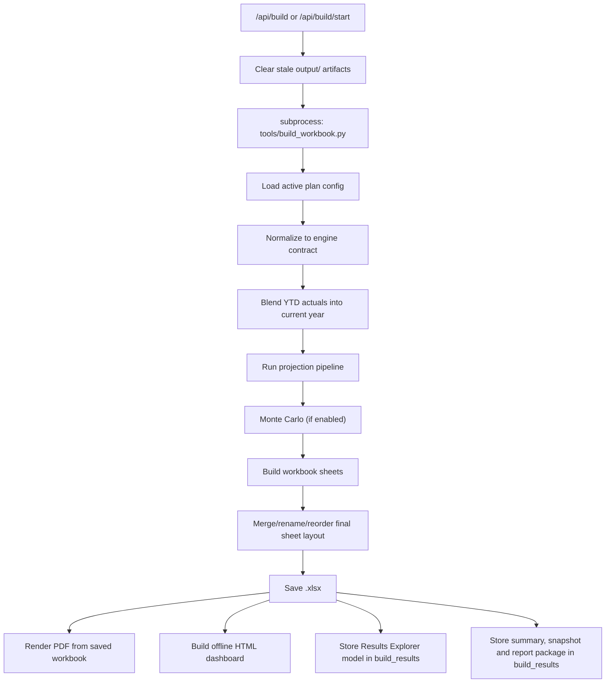

# Retirement Planning System — Current System Design Spec

Generated: 2026-08-29, updated 2026-09-30 (§7.3 nav model, housing optimizer,
Spending Adjustments; WI-703), and 2026-10-12 for WP11 (file-free storage: plan
data in the plan file, per-install state in `app.db`, CSV only through
`csv_exchange`). This describes the system as implemented in the
current codebase, verified against source (not against prior design docs).
Where an earlier design intent has been superseded, this document describes
only what the code does now. See `documentation/reference/FUNCTIONAL_SPEC.md` for the
companion functional/behavioral spec.

## 1. Purpose

A local-only desktop retirement planning system. It combines structured
household plan data, investment holdings, spending actuals, market pricing,
a deterministic + Monte Carlo projection engine, and advisor-grade reporting
into one guided workflow, running entirely on one machine for one household
at a time.

## 2. System context

## 3. Runtime architecture

### 3.1 Entry points

- `main.py` — sets `RETIREMENT_SYSTEM_*` local-mode environment defaults
  (`APP_MODE=LOCAL`, `WORKSPACE_ID=local`, `DASHBOARD_PORT=5050`,
  `REQUIRE_API_TOKEN=NO`), runs a one-time at-rest Plan Data migration, then
  dispatches to desktop or server mode. In the frozen exe, any argument
  ending in `.py` is handled by a script-runner branch (`runpy.run_path`) —
  this is how the build subprocess launches from a packaged app.
- `src/desktop_app.py` — desktop mode: opens a PyWebView native window on
  `frontend/index.html`.
- `src/desktop_api.py` (`DesktopApi`) — the JS↔Python bridge for desktop
  mode. `frontend/js/pywebview_bridge.js` intercepts every `fetch()` call and
  routes it through `window.pywebview.api.request(method, url, body)` →
  `DesktopApi.request()` → `app.test_client()` (the in-process
  `wsgi_facade.TestClient`). **No HTTP socket is ever opened in desktop
  mode** — it drives the identical route registry in-process. Binary
  downloads are special-cased: written to a temp file, then opened via
  `os.startfile`/`open`/`xdg-open`.
- `src/http_runtime/server.py` — server mode: a stdlib `ThreadingHTTPServer`
  on `127.0.0.1:5050`, opening a browser tab.
- `src/http_runtime/wsgi_facade.py` — a dependency-free, hand-built
  Flask-compatible facade: `Flask`, `Response`, `request`/`g` (via
  `contextvars`), route compilation (`<name>`, `<int:name>`, `<path:name>`),
  before/after-request hooks, `jsonify`, `send_file`, and an in-process
  `TestClient`. There is no Flask/Werkzeug/Jinja dependency anywhere in the
  packaged app.

Both launch modes route through the same `src.server.create_app()` object
and the same route/service code — the only difference is whether requests
arrive over a real socket or an in-process test client.

### 3.2 Request lifecycle

- **Server mode:** browser → TCP socket → `_Handler._handle()` parses the
  raw HTTP request → `app.handle_http(...)` → `Flask.dispatch_request`
  (`before_request` hooks including the security gate, route match,
  `after_request` including local CORS) → a route function in
  `plan_routes.py` / `workbook_routes.py` / `admin_routes.py` /
  `base_routes.py` → typically delegates to a `src/server_services/*.py`
  module → reads/writes the active plan file (`plan.rpx`) and/or `app.db` → `jsonify(...)`.
- **Desktop mode:** identical, minus the socket — see §3.1.

### 3.3 Route registration and module structure

Routes are registered as decorator side effects at import time. `src/server/
__init__.py` imports `base_routes`, `workbook_routes`, `plan_routes`,
`admin_routes` — in that order, purely for their `@app.route(...)`
registration side effects. Each of those files does `from .app_core import *`
(plus `from .security_audit import *`, re-exported through `app_core`) to
share the `app` object, helper functions, and constants — a single shared
namespace, not separately-scoped modules.

`src/server/route_manifest.py` and the stub files under `src/server/
features/` are **not route modules** — every actual `@app.route` call lives
in the four files above. `route_manifest.py` is a hand-maintained ownership
manifest used for documentation/introspection tooling only; a reader should
not infer route-level modularity from `features/`'s existence.

`src/server_services/*.py` hold the business logic behind most routes,
deliberately HTTP-framework-agnostic: they take plain dicts/paths/callables
and return `(payload, status)` tuples. The route layer owns permission
checks, request parsing, and JSON serialization; services own everything
else. Current service modules: `base_service`, `admin_service`,
`build_service`, `build_job_service`, `blank_plan_service`, `config_service`,
`conversion_service`, `demo_plan_service`, `holdings_service`,
`plan_file_service`, `plan_forms_service`, `plan_tier_service`,
`portfolio_service`, `pricing_service`, `report_service`, `secret_service`,
`spending_service`, `strategy_asset_service`, `ytd_service`.

### 3.4 Route → service map

| Route group | Representative routes | Backing module |
|---|---|---|
| Build/results | `/api/build/start`, `/api/build/preflight`, `/api/build/status`, `/api/detailed-results`, `/api/report-package`, `/api/history`, `/api/xlsx`, `/files/<path>` | `workbook_routes.py` → `build_service.py`, `build_job_service.py`, `report_service.py` |
| Blank plan and CSV import/export | `/api/plan/blank`, `/api/import/preview`, `/api/import/commit`, `/api/export/plan-set`, `/api/export/<dataset>` | `workbook_routes.py` → `blank_plan_service.py`; `import_export_routes.py` → `csv_exchange` |
| Plan forms (plan file) | `/api/plan/forms`, `/api/plan/forms/<path>` | `base_routes.py`/`workbook_routes.py` → `plan_forms_service.py` → `active_plan.py` |
| Plan file lifecycle | `/api/plan/save-as`, `/api/plan/load-file`, `/api/plan/exit-snapshot`, `/api/plan/snapshot/compare`, `/api/plan/snapshot/restore` | `plan_routes.py` → `plan_file_service.py` |
| Config/rows | `/api/config/backends`, `/api/config/rows`, `/api/allocation-preview`, `/api/daf/recommendation` | `plan_routes.py` → `config_service.py` |
| Pricing | `/api/prices/refresh`, `/api/prices/snapshots`, `/api/prices/freeze`, `/api/prices/test-symbol[/start\|/status]` | `plan_routes.py` → `pricing_service.py` + `portfolio_analytics.py` |
| Spending | `/api/spending/dashboard`, `/api/spending/budget*`, `/api/spending/taxonomy*`, `/api/spending/rules*`, `/api/spending/alias*` | `plan_routes.py`/`workbook_routes.py` → `spending_service.py` |
| YTD | `/api/ytd/status`, `/api/ytd/transactions*`, `/api/ytd/account-setup*` | `plan_routes.py` → `ytd_service.py` |
| Strategy/assets/estate | `/api/holdings*`, `/api/liabilities`, `/api/large-discretionary-expenses`, `/api/forced-roth-conversions`, `/api/insurance-policy*`, `/api/trust-account/add`, `/api/housing/*`, `/api/capital-market/*` | `plan_routes.py`/`workbook_routes.py` → `strategy_asset_service.py`, `holdings_service.py` |
| Portfolio | `/api/portfolio/drift` | `plan_routes.py` → `portfolio_service.py` → `portfolio_analytics.py` |
| Secrets | `/api/secrets` (POST only) | `plan_routes.py` → `secret_service.py` → `secrets_store.py` |
| Admin | `/admin`, `/api/admin/diagnostics`, `/api/admin/system-config`, `/api/admin/csv-backup` (plan-set CSV export zip), `/api/admin/server*` | `admin_routes.py` → `admin_service.py` |
| Base/runtime | `/`, `/api/ping`, `/api/runtime`, `/api/prefs`, `/api/contracts`, `/api/glossary`, `/api/auth/*`, `/login` | `base_routes.py` |
| Demo plan / plan registry | `/api/plan/demo-status`, `/api/plan/open-demo`, `/api/plan/exit-demo`, `/api/plan/reset-demo`, `/api/plans`, `/api/plans/switch`, `/api/plans/rename`, `/api/plans/forget` | `plan_routes.py` → `demo_plan_service.py`, `plan_registry.py` |

`documentation/reference/API_CONTRACTS.md` documents a curated subset of "stable"
contracts, not the full route inventory — treat this table and the route
files as the source of truth for completeness.

### 3.5 Workspace and paths

`src/platform_runtime.py` distinguishes `package_root()` (code, read-only
assets) from `workspace_root()` (writable `output/`, `local_state/`,
`saved_plans/`, and `input/`, which the app creates but does not keep plan
data in; redirectable via
`RETIREMENT_SYSTEM_WORKSPACE_ROOT` for tests). `src/workspace_context.py`
layers desktop-only path helpers over it. `active_workspace_id()` /
`active_client_id()` are hardcoded to the literal string `"local"` —
multi-tenant plumbing (`workspace_id`, `client_id` parameters) is present
throughout the codebase but always resolves to this one value; there is no
multi-tenant capability in the current package.

**Path resolution in the frozen exe:** `BASE_DIR` in `app_core.py` resolves
to `_internal/` (the PyInstaller bundle root), not the exe's parent
directory. Writable user data must be resolved relative to `sys._MEIPASS` or
the exe path, not `BASE_DIR`, in frozen mode. A frozen build ships the seed demo
plan (`src/reference/demo_seed.rpx`) and the read-only reference database
(`src/reference/reference.db`), not the `input/demo` CSV folder.

## 4. Data architecture

### 4.1 Canonical source hierarchy

0. **`<workspace>/plan.rpx`** (the plan file, `PlanStore`; one file per plan) —
   the only store of plan data. It holds the sectioned plan data (`plan_rows`:
   household, income, spending, assets, policy, switches and tier); the flat
   datasets as tables (`holdings_lots`, `liabilities`, `hsa_schedule`,
   `target_allocation`, the `spending_*` tables and the `ytd_*` tables);
   `build_results` (the KPI summary, Results Explorer model, report package,
   build snapshot and pricing diagnostics of the last 5 builds); and
   `plan_revisions`, `revision_rows` and `plan_meta`. The active plan is found
   by `src/active_plan.py` (`RETIREMENT_SYSTEM_PLAN_DB` or the plan registry).
   Readers use `active_plan_data()` / `load_active_config()`; every writer
   edits through `active_plan.edit_active_plan()` in one transaction. No CSV,
   JSON or YAML file mirrors it. See `documentation/reference/PLAN_ROWS_MODEL.md`.
1. **`<workspace>/local_state/app.db`** (`AppStore`, `src/app_state.py`;
   `RETIREMENT_SYSTEM_APP_DB` overrides the path) — per-install state that
   survives plan switches: `settings` (runtime settings, preferences, backup
   and Monarch policies, workbook format overrides, and the names of stored
   secrets), `plan_registry` and `active_plan` (the plan files known to the
   install and the one that is active), `audit_events`, `admin_change_log`,
   `run_history`, `last_build`, `backup_manifest` and `price_cache`. Secret
   values are not stored here (§9).
2. **`local_state/retirement_system_v10.db`** — the legacy local database. It
   holds no plan data. Its live writers are `src/local_store.py` (KPI
   snapshots written by each build, result snapshots, `local_settings`) and
   `src/portfolio_analytics.py` (`price_snapshots` and
   `pricing_snapshot_freezes`). Its `client_files` table (the old flat-dataset
   text) is read only by the one-time converter (`src/legacy_conversion`, WP10).
3. **`input/`** — not a data store. The sectioned CSV set (`client_data.csv`
   and its part files), the flat-dataset CSV files and `system_config.csv` are
   no longer read or written at runtime. CSV enters and leaves only through
   `src/csv_exchange` (plan-set and per-dataset import and export). `input/demo`
   is the source of the shipped seed plan (`tools/build_demo_seed.py`); the
   converter reads old `input/` files once.

**Flat datasets** (holdings, liabilities, HSA schedule, target allocation,
spending, YTD) are tables of the plan file, not section/subsection/label rows.
The feature routes read and write them through `src/plan_datasets.py`
(`active_dataset_text()` / `write_active_dataset()`), which render and parse the
CSV text the routes speak. `_read_plan_data_file()` and `_write_plan_data_file()`
in `app_core.py` are thin helpers over the same tables. No CSV file and no
`client_files` row is written. The `/api/plan-data/*` routes are removed (WP9 follow-up).

### 4.2 Concurrency

`src/plan_file_io.py`: `plan_file_lock()` (a per-path reentrant
`threading.RLock`, needed because the server is a `ThreadingHTTPServer`)
wraps `atomic_write()` (unique temp file + `os.replace`).

### 4.3 Plan snapshot lifecycle

Save As, Load Saved Plan and Save & Exit (`plan_file_service.py`) operate on
the **whole plan file**, not row-level. Save As copies the active plan file to
a user-chosen path through the SQLite backup API (`plan_db_replace.copy_sqlite_file`,
WAL folded in), registers the copy and activates it (`activate: false` only
records it). Load Saved Plan (default `mode: open`) registers the chosen file
and activates it without copying. `mode: restore` replaces the active plan
file's contents through `plan_db_replace.replace_active_db` with
`validate_plan_file`: the selected file must open as a plan file, the active
file is backed up, the WAL is checkpointed (`PRAGMA wal_checkpoint(TRUNCATE)`,
preventing stale WAL data from silently rolling back a loaded plan), the
replace is atomic and the `-wal`/`-shm` sidecars are removed; then
`plan_data_migration.migrate_plan_file` re-applies the label renames to the
loaded rows. Plans are listed and switched through the plan registry in
`app.db` (`src/plan_registry.py`, `/api/plans*`). Demo: the demo plan is
`<workspace>/demo.rpx`, copied from the shipped seed (`demo_seed.rpx`); the
`input/demo` CSV is used only when that seed is absent (source runs).

Backups written by these paths (old copies are pruned to the last N):

- `plan.rpx.version_<timestamp>` (beside the plan file) and `retirement_system_v10.db.version_<timestamp>` (in `local_state/`) — on Save & Exit, last 10 kept.
- `plan.rpx.before_load_<timestamp>` — before a `mode: restore` load.
- `plan.rpx.before_snapshot_restore_<timestamp>` — before a build-snapshot restore.
- `plan.rpx.before_blank_<timestamp>` (and the legacy database's `before_blank` copy) — before Start New Plan clears the household facts.

Build-time reproducibility snapshots are separate: `src/build_snapshot.py`
builds the `build_snapshot_v1` document (fingerprints and hashes of build
artifacts), stored in the build's `build_results` row (`snapshot_json`). It
also copies the plan file beside the outputs as `plan_database_snapshot.rpx`.
The compare and restore endpoints in §3.4 use both.

### 4.4 Schema and migration

- `src/schema_registry.py` loads the field catalog from the shipped
  `reference.db` (built from `reference_src/schema.csv` plus a generated
  coverage backfill) into a `(section, subsection, label) → spec`
  map, used for validation, UI type inference, and `/api/config/rows`
  metadata.
- `src/plan_data_migration.py` — a versioned (`PLAN_DATA_SCHEMA_VERSION = 5`)
  idempotent at-rest **label-rename** migration (e.g. `husband_*` →
  `member_1_*`), applied to the plan file's rows (in place,
  one transaction with rollback on error), run once at startup by `main.py`.
- `src/plan_data_backfill.py` — a separate, declarative mechanism
  (`PLAN_DATA_BACKFILL_ENTRIES` in `app_core.py`) that inserts *new*
  canonical rows (e.g. Roth conversion params, HELOC, QCD, TLH) into
  the active plan's `plan_rows` at defined anchor points inside their section
  (WP4.4c; formerly into the CSV files) — additive schema
  evolution, distinct from the rename migration above.
- `src/plan_data_registry.py` — the single-source list of sectioned CSV file
  names (`CLIENT_DATA_PART_FILES`; the converter and test fixtures only since WP4.5) and the flat dataset lists, consumed by ~8 other modules to avoid
  copy-paste drift.

### 4.5 Plan row schema

Most plan facts use a six-column logical row: `section`, `subsection`,
`label`, `value`, `units`, `notes` — used by the `csv_exchange` text form, the schema
registry, UI rendering, and reporting inputs.

## 5. Build pipeline

A "build" (workbook/report generation) runs `tools/build_workbook.py` as a
**subprocess** of the server process (`sys.executable -u
tools/build_workbook.py`, or the frozen exe's script-runner branch). Two
trigger paths:

- **Sync** (`POST /api/build`): `subprocess.run(..., timeout=cfg.
  max_build_seconds)`; `build_service.interpret_build_result()` reads
  the build's summary row (`build_results`), checks it against a `RETIREMENT_SYSTEM_BUILD_ID`
  stamp to detect staleness, and regex-scans stdout for `"QC: n/n PASS"`.
- **Async** (`POST /api/build/start`): spawns a daemon `threading.Thread`
  (`build_job_service.run_build_progress_job`) that launches the same
  subprocess with line-buffered stdout, maps each line through
  `build_progress_from_line()` (regex heuristics, e.g. mapping "Monte Carlo
  exact scalar paths: n/total" to a 0–99% progress bar and a phase string),
  and stores state in an in-memory `BuildJobRegistry` (thread-safe dict
  keyed by `job_id`, pruned after 1 hour — **no persistent/multi-user build
  queue**, by design, for a single-user desktop app). Progress is polled via
  `GET /api/build/progress/<job_id>`, streamed via SSE at
  `/api/build/events/<job_id>`, or pushed directly into the desktop webview
  (`DesktopApi._push_build_progress` → JS `updateBuildProgress(...)`).

`run_build_progress_job` also diffs the local admin-config change log
between the previous and current build timestamps (the "Build Impact"
feature) and records the last build in `app.db` (`last_build`) on success.

Before a build, `_clear_current_build_outputs()` deletes stale `output/`
artifacts so old outputs can't be mistaken for the in-flight build.
`GET /api/build/preflight` (`build_service.build_preflight_payload`) reports
readiness (`current`/`ready`/`warning`/`blocked`) by comparing artifact
mtimes against the plan file's last change, checking for missing-required/
schema-invalid Plan Data rows, and summarizing pricing-diagnostics
fallback/failure counts.

`src/build_entry.py::run_build()` is an alternate in-process (non-subprocess)
entry point for a host that cannot spawn a second interpreter (a future/
parallel platform target): it calls `reporting.workbook_builder.main()`
directly, which reads the plan file (no folder sync and no file materialization). **Not wired into either
desktop or server HTTP routes as of this reading.**

Output files land in `output/plans/<plan_id>/` (per plan; the shared `output/`
folder is read only as a fallback for pre-WP7 builds): `retirement_plan.xlsx`,
`retirement_plan.pdf`, `retirement_dashboard.html` and
`plan_database_snapshot.rpx`. The build's JSON parts (KPI summary, Results
Explorer model, report package, build snapshot, pricing diagnostics) are
columns of the plan file's `build_results` row, not files. The last build,
run history and admin change log are rows of `app.db`.

## 6. Projection/engine architecture

### 6.1 Pipeline facade vs. the real engine

`src/projection_pipeline.py::run_projection_pipeline()` is a thin,
self-describing facade: it wraps one call to `planning_engines.project()` in
narrative "stage" events (`DEFAULT_STAGE_ORDER` — 14 named stages such as
`DeathTransition`, `Spending`, `WithdrawalCascade`, `TaxAssessment`,
`NetWorth`). **This decomposition is explicitly not real yet** —
`STAGE_IMPLEMENTATIONS` is empty and every stage reports `"inlined"` rather
than `"completed"`; all computation happens inside one function. This exists
for observability/testability, as a scaffold toward eventual real stage
extraction (`src/projection_stages/year_state.py` — separating mutable
per-run state from immutable config — is the first concrete step in that
direction).

### 6.2 The real deterministic engine

`src/projection_stages/deterministic_engine.py::run_deterministic_
projection_stage(c)` (imported as `project()` via `planning_engines.py`) is
the actual year-by-year loop from `plan_start` to `plan_end`. As of ticket
3.10 (engine decomposition, PRs #102–#106), the loop body itself is no
longer one large inline function: `deterministic_engine.py` (~1,300 lines)
drives the per-year sequence by calling out to real, independently-defined
stage functions in ~17 sibling modules under `src/projection_stages/`,
sharing per-year mutable state via `year_state.py`
(`MutableYearState`/`create_initial_year_state`). Roughly:
`deaths_and_spousal_rollover.py` (death/filing transitions),
`appreciation_divorce_qlac.py` (asset appreciation, one-time divorce/QDRO
split, QLAC premium logic), `income.py` (earned, equity comp, disability,
Social Security, annuity/pension), `amt_equity_comp_true_up.py` (AMT/equity
comp true-up), `spending_and_rmd.py` (spending and RMDs), `home_sale.py`
(home-sale logic), `roth_conversion_and_agi_tax.py` (Roth conversions and
AGI/tax assessment), a cluster of `withdrawal_cascade_*.py` modules (gap
assembly, HSA priority draws and reimbursement correction, taxable/trust
withdrawal, DAF carryforward makeup, final draws, IRA true-up, and
investment-tax/TLH/gain-harvest handling), `portfolio_growth_and_net_worth.py`
(end-of-year growth and net worth roll-up), plus `effective_marginal_rate.py`
and `cashflow_breakdown.py` for supporting per-year computations. The
per-year *order of operations* this decomposition implements is unchanged:
death/filing → appreciation → income → spending → RMDs → Roth conversions
(IRMAA/ACA-PTC guardrail-aware) → tax assessment (federal/state/NIIT/IRMAA/
AMT) → the withdrawal cascade (with in-loop TLH/gain harvesting) →
end-of-year growth → net worth roll-up (nominal and CPI-deflated) →
per-year event log entries (`EvIncome`/`EvWithdraw`/`EvTax`/`EvTransfer`/
`EvHomeSale`/`EvGrowth`/`EvDeath`/`EvRMD`/`EvWarning`) for traceability.
Output is a list of per-year row dicts — the shared contract consumed by
reporting, optimization, and Monte Carlo alike. This internal decomposition
is a distinct effort from, and should not be confused with, the
`projection_pipeline.py` narrative facade in §6.1, which remains unreal
(empty `STAGE_IMPLEMENTATIONS`) and was not touched by this refactor.

### 6.3 Monte Carlo engines

Two engines share one config contract (`src/planning_engines.py`):

- **`monte_carlo_exact_scalar()`** — re-runs the true scalar deterministic
  engine once per sampled path (`_run_one_mc_path`). Highest fidelity,
  slower; used for smaller sample counts and validation/parity.
- **`_mc_vectorized_projection()`** — a batched NumPy approximation that
  replays each path's account "buckets" (pretax/roth/taxable/hsa/cash)
  without re-running the full tax engine per path; used for large sample
  counts. `src/governance.py::model_risk_rating()` formally tracks which
  engine produced a given result and flags vectorized output as
  approximate — pending tolerance-bounded scalar parity, not a settled
  equivalence.

Both engines report a shared metric set: success rate, essential-fully-
funded probability, percentile net-worth/spend paths, tax NPV/ELTR
distributions, and the Guyton-Klinger guardrail shadow. `src/
vectorized_fast_core.py` centralizes covariance/moment math
(`portfolio_moments`) so the optimizer and both MC paths compute portfolio
statistics identically.

### 6.4 Optimization and scoring

- `optimize_roth_conversion_strategy()` scores ~30 candidate conversion
  policies via a multi-component LCV-based objective (lifetime-tax penalty,
  legacy/estate/survivor/ACA-PTC/liquidity components, weighted per a
  configurable `roth_objective_mode`), runs a 200-sim Monte Carlo per
  candidate to compute feasibility probability, hard-excludes any candidate
  below the 95% feasibility gate from selection, and falls back to ranking
  the full set (flagged `roth_all_candidates_infeasible`) if none clear it.
- `src/optimization.py` computes asset allocation across five selectable
  modes (user target / optimizer risk-budgeted / max-Sharpe / pure tangency
  / holding-period real-loss-aware) via mean-variance solves, incorporating
  human capital and guaranteed-income/home-equity "coverage" of
  fixed-income/REIT sleeves, and a per-asset-class include/exclude/defer
  policy (`compute_allocation_coverage`).
- `src/withdrawal_strategy_comparison.py` is a **separate, lower-fidelity**
  side-by-side of named withdrawal orders — not a re-run of the real
  cascade; it uses flat marginal/LTCG rates instead of the engine's true
  multi-round tax true-up.
- Tax NPV/ELTR: both MC engines discount each year's `total_tax` to plan
  start to get `tax_npv`, then divide by discounted gross external cash flow
  for `effective_lifetime_tax_rate`, reported as percentiles.
- `compute_baseline_lcv_and_eltr(c, rows)` and `compute_future_lcv_and_eftr(c,
  rows, as_of_year=None)` (`src/planning_engines.py`) are the single-run,
  non-candidate counterparts of `_roth_strategy_metrics`'s `lcv_score` and
  the MC engines' tax-NPV/ELTR: same discount rate (`_roth_discount_rate`)
  and PV mechanics, applied to the plan's own built projection rather than a
  Roth-conversion candidate. The baseline variant discounts to `plan_start`
  (whole-lifetime, comparable to the optimizer/MC figures); the future
  variant discounts to `as_of_year` (default: `platform_runtime.today().year`,
  so tests can pin it) and excludes rows before that year. Both are wired
  into the build's KPI summary (`build_results`, `lcv`/`eltr`/`fcv`/`eftr`) by
  `workbook_builder.py`, and the future variant is also called directly by
  `sheets_summary_builder.py::build_sheet1` for the Executive Summary's
  Forward-Looking Metrics rows.

### 6.5 Stress scenarios

`src/reporting/sheets_stress.py` re-runs the deterministic engine with
config overrides (`run_scenario`): allocation mode, retire-later,
spend-more, sell-home, high-inflation, low-return, PDIA dividend/split
variants, "No Social Security Benefit Cut" (zeroing the base-case haircut),
"Divorce/QDRO Asset Split" (one-time proportional, tax-free reduction of
every investment account balance at a configured year, applied directly
against balances before growth that year — IRC §1041, no ongoing
alimony/support modeling), and a stackable Combined Stress Test.

### 6.6 Architectural patterns

- **Config-gated feature toggles.** Advanced modules are gated behind
  `c['opt']` flags or explicit policy strings, deliberately independent of
  any `module_enabled()`/optional-function mechanism, so a default plan
  (all off) projects byte-identically and golden-master tests never move.
- **Money/domain boundary.** `src/money.py`/`src/domain_models.py`
  establish Decimal-at-the-boundary, float-for-execution: user input is
  parsed as Decimal cents, converted to float for the legacy numeric engine,
  with `PlanInput`/`Account`/`Member` as a typed local domain model layered
  over the sectioned plan-data shape (`sectioned_data()`).
- **Shared selection logic between engine and reporting.** TLH,
  gain-harvest, and holding-period modules are pure, side-effect-free
  "select" functions imported both by the projection engine (which mutates
  lots to actually harvest) and by reporting sheets (which call the same
  selector to build a "what would be harvested" ledger) — the sheet and the
  projection cannot disagree about what qualifies.
- **Account-registry indirection.** `src/core.py`'s consolidated
  `account_registry`/`account_access` addresses accounts by owner/
  tax-treatment/type traits rather than hardcoded account names, with an
  optional per-account draw-priority override that stable-sorts the cascade
  without disturbing unprioritized accounts.

## 7. Frontend architecture

### 7.1 Shell

`frontend/index.html` — a single-page shell: header with global actions
(Save, Download Workbook/PDF, Exit), a left guided-steps navigator
(`#sideNav`), a center pane (`#mainPane`, replaced wholesale on every
render), and a right contextual-help pane. `frontend/admin.html` is a
structurally parallel, separately-rooted shell for the admin console, driven
by `frontend/js/admin.js` rather than the dashboard scripts.

### 7.2 Monolith-being-decomposed pattern

This is not a bundler-based SPA. ~30 `dashboard_decomp_*.js` files plus
`dashboard.js` itself (still ~7,500 lines) are loaded as a mix of classic
`<script>` and ES `type="module"` tags. `dashboard.js` remains the core: it
owns the `STEPS` catalog (~35 guided steps with id/group/title/help), the
large `renderMain()` string-template switch, and dozens of module-level `let`
globals (`rows`, `activeStep`, `planLoaded`, `holdingsChanged`, etc.). Each
`dashboard_decomp_*` file is a mechanically extracted slice of that
monolith — each carries a header comment naming exactly which `dashboard.js`
globals it still reaches back into via `window.*` bridging, and most also
`Object.assign(window, {...})` their own exports so inline `onclick="..."`
HTML strings can call them.

A handful of files are genuine, independent modules rather than extracted
slices:

- `app_store.js` — a small pub/sub state container mirroring a few
  top-level flags; explicitly scaffolding for further decomposition, not
  yet the source of truth.
- `api_client.js` — a dependency-free `fetch` wrapper adding CSRF header
  injection and timeout/abort support.
- `navigation.js` — step transitions, the autosave-vs-explicit-save step
  classification, plan-independent steps, and step redirects.
- `reports_ui.js` — renders the Results Explorer (workbook sheet browser).
- `planning_workbench_ui.js` — a browser-local-only "Planning Case" store
  (localStorage), documented as never mutating the saved plan.
- `spending_dashboard.js` — the tabbed Spending workspace.
- `pywebview_bridge.js` — desktop-mode `fetch()` interception (see §3.1).

**Rendering pattern.** No virtual DOM or component framework: `renderMain()`
builds one HTML string per active step and does one `innerHTML` write per
navigation, with hand-rolled focus/selection/`
`-open-state
preservation across the replace. Server communication is plain `fetch`/
`api()` with CSRF tokens; there is no client-side router beyond `setStep(id)`.

### 7.3 Navigation model

Guided steps are grouped (in `STEPS`, `frontend/js/dashboard.js`): Plan
Status, Household, Income & Benefits, Spending, Investments & Property,
Insurance & Care, Estate & Legacy, Taxes, Family & Business, Strategy,
Reports & Review and Settings, plus the cross-cutting Planning Workbench (no
group). The former Housing & Property group was dissolved in #338: housing
costs are edited in Spending Model's Housing accordion, home value and
mortgage balance on Other Assets and Liabilities, and sale / next steps /
residency in Strategy → Optimize → Next Housing Move. Optional-module-gated
steps show an explanatory placeholder when their module is off rather than
being removed from navigation. Settings → Plan Features
(`optional_functions`) is the one place optional modules are switched.

#### 7.3.1 Housing optimizer and Next Housing Move

`src/housing/` is the housing move optimizer package (the older
`src/housing_optimizer.py` remains as a re-export shim). A candidate is an
original-home disposition (sold in a searched year, or kept) plus a tuple of
up to five `Move`s, each with its own acquisition year and an explicit
buy/rent action; selling is decoupled from moving. `src/housing/zip_screen/`
is Stage 1 (ZIP screening) and produces ordinary `Location` objects, so the
search, scoring, constraint and plan-variant modules never see ZIP codes.
`plan_variant.py` is the only place that knows the plan-config wire format or
calls the engine. The UI is `dashboard_decomp_housing_optimizer.js`, rendered
as the Next Housing Move section of Optimize and gated by the
`housing_location_search` module (off: the section shows its saved values
without applying them). Routes: `/api/housing/optimize`,
`/api/housing/zip-screen`, `/api/housing/zip-lookup`,
`/api/housing/top-cities`, `/api/housing/state-estimate`,
`/api/housing/seed`.

#### 7.3.2 Spending Adjustments and Large Discretionary

`src/spending_adjustments.py` implements category step-downs/step-ups
(`adj_N_category/start_year/end_year/change_pct` plan rows under Cashflow /
Spending Adjustments, served by
`/api/spending-adjustments`); factors compound multiplicatively in start-year
order and `ALL:<tracking type>` rows compound with a category's own rows.
Only Core Expenses, Housing, Wellness and Travel are adjustable. Large
Discretionary is a one-time-only model: `migrateLargeDiscLines`
(`dashboard_decomp_large_discretionary.js`) converts legacy repeating rows
into one dated row per year and never annualizes.

## 8. Reporting/output architecture

### 8.1 Orchestration

Entry point: `src/reporting/workbook_builder.py::main()`. Flow: load active
plan config → checkpoint SQLite WAL → normalize into the engine contract
(`prepare_config_from_sectioned_data`) → optional HSA default-schedule
generation → blend YTD actuals into the current projection year → run the
full projection pipeline (Monte Carlo included when enabled) → build every
workbook sheet function-by-function into an `openpyxl.Workbook` →
`apply_final_workbook_structure()` (merge/rename/reorder legacy build-time
sheet names into final numbered tabs) → layout/format passes (column-width
overrides, numeric centering, template layout, row-height minimization) →
save `.xlsx` → post-save XML patch (chart title fonts) → generate PDF from
the same saved workbook object → generate the HTML dashboard from the
workbook → store the Results Explorer model, KPI summary, build snapshot and
report package in the build's `build_results` row.

The build's KPI summary (the `summary` part of `build_results`, formerly `plan_summary.json`) is the one place both the UI and the Excel
Executive Summary read headline figures from: `terminal_nw`/`lifetime_tax`
(nominal, whole-lifetime), `lcv`/`eltr` (whole-lifetime, plan-start PV,
comparable to the Roth optimizer's and Monte Carlo's own figures), and
`fcv`/`eftr` (forward-looking, PV to today, excluding elapsed years). The
Executive Summary sheet (`sheets_summary_builder.py::build_sheet1`) renders
the first two groups as "Headline Numbers" and the third as its own
"Forward-Looking Metrics (From Today)" sub-section, rather than mixing them,
since they answer different questions ("over the whole plan" vs. "from here
forward").

`src/report_compute.py` is the framework-free orchestration layer (parse →
normalize → optimize → project → validate → Monte Carlo) shared by both the
workbook builder and plain API/test paths, deliberately free of any
openpyxl dependency. `src/dashboard_ui/builder.py` copies
`frontend/` into `output/` so a built workbook bundle can open the offline
dashboard without a running server.

### 8.2 Four artifacts, one source of truth

See `documentation/reference/FUNCTIONAL_SPEC.md` §5 for the audience-facing summary.
Architecturally: the Excel workbook is canonical; the PDF renders every
visible sheet of the *already-built* workbook object directly (not a
separately maintained subset) so it cannot drift from Excel; the HTML
dashboard re-opens the saved `.xlsx` with `data_only=True` and reads a
hidden `_Chart Dashboard Data` helper sheet (falling back to deriving series
from projection rows if the Charts module is off); the Results Explorer JSON
model is built by re-parsing the saved workbook (`src/detailed_results.py`)
into a renderer-neutral semantic model (`ReportSpec`/`ReportPage`/
`ReportSection`/`ReportTable`/`ReportChart` dataclasses in
`src/report_spec.py`), capped for browser performance
(`DETAILED_RESULTS_SAFE_MAX_ROWS=260`, `CHART_MAX_POINTS=45`).

`src/report_package.py` ties the four together: per-artifact existence/
size/sha256/mtime, contract/schema versions, required-vs-optional status,
and renderer roles — a QC/integrity layer, not a user-facing document.

### 8.3 Module catalog

`src/module_catalog.py` is the single source of truth classifying every
optional workbook output by the question it answers — **Projection**
("what happens as-is?"), **Optimization** ("what lever should I change?"),
**Stress test** ("does it survive events outside my control?"),
**Diagnostics** ("is the model trustworthy?"), **Reference** ("what
produced this?") — with each `OutputModule` entry declaring its
`requires_inputs` and `requires_outputs`. This is the same dependency graph
the sheet-builder call order in `workbook_builder.py::main()` follows
procedurally, and the mechanism behind `OPTIONAL_MODULE_SHEETS` gating in
`src/reporting/workbook_common.py`: a disabled module is neither built nor
sheeted — no logic executes for it at all.

## 9. Security and permissions posture

The current package is explicitly single-user and local-only, with
SaaS/multi-tenant scaffolding retained as unreachable code rather than
removed. This is a stated design choice ("the local machine boundary is the
primary trust boundary"), not an oversight — but every layer below resolves
to "always allow," and a spec reader should treat the permission machinery
as **present but inert**, not as enforced access control:

- `src/runtime_config.py`: `VALID_APP_MODES = {LOCAL}`; `load_runtime_
  config()` hardcodes `app_mode = LOCAL` unconditionally regardless of
  the stored settings.
- `src/permissions.py`: `UserContext` always has role `"advisor"`, and
  `LOCAL_PERMISSIONS` grants every permission unconditionally — `require()`
  can never deny in the current configuration.
- `src/server/security_audit.py::_authorized_and_identity()` always returns
  `(True, None)`; the `before_request` security gate therefore never
  rejects a request except for a dead-code HTTPS-redirect branch and the
  OPTIONS short-circuit. Bearer/API-token identity resolution still exists
  and populates `g.user_context` if a token is presented, but nothing
  requires one.
- CORS (`_local_cors`) sets `Access-Control-Allow-Origin: *`
  unconditionally, by design — trading away CSP/X-Frame-Options headers
  that would otherwise break `dashboard.js`'s inline `onclick="..."`
  handlers.
- **Secrets storage** (`src/secrets_store.py`) keeps API keys in the OS
  credential store through `keyring` (Windows Credential Manager is the primary
  target; macOS Keychain and Secret Service also work). Only the secret names
  are indexed, in `app.db` settings (`secrets.names`). There is no plain-text
  fallback: with no usable credential store, set operations raise
  `SecretStoreUnavailable`, and the pricing path treats the key as absent and
  surfaces a warning. `migrate_legacy_secrets_file` (used by the converter)
  moves a legacy `local_state/secrets.local.json` into the credential store and
  deletes it only after every key reads back.
- **Audit logging** (`_audit()`) writes redacted events to the `audit_events`
  table of `app.db` (the old `output/audit_log.jsonl` file is gone); `redact_text()` in
  `src/security.py` regex-scrubs obvious `api_key=`/`token=`/`password=`
  patterns before logging — best-effort pattern matching, not guaranteed
  redaction.

## 10. Known architectural notes for future readers

- `projection_pipeline.py`'s 14-stage decomposition is a facade over one
  large function, not yet real (§6.1) — do not assume individual stages can
  be tested, replaced, or reasoned about independently of the whole.
- Vectorized Monte Carlo output is explicitly labeled approximate relative
  to exact-scalar (§6.3); treat differences between the two as expected
  until a tolerance-bounded parity check exists.
- `route_manifest.py` describes route *ownership* for tooling, not actual
  route module boundaries (§3.3) — the four route files remain a single
  shared namespace.
- Multi-tenant identifiers (`workspace_id`, `client_id`) persist throughout
  the codebase but are hardcoded to `"local"` everywhere they resolve
  (§3.5) — there is no multi-tenant capability to build on top of without
  first removing this constraint deliberately.
- `src/build_entry.py::run_build()` is a working, unused alternate build
  entry point for a non-desktop host (§5) — it is not currently reachable
  from either shipped launch mode.
